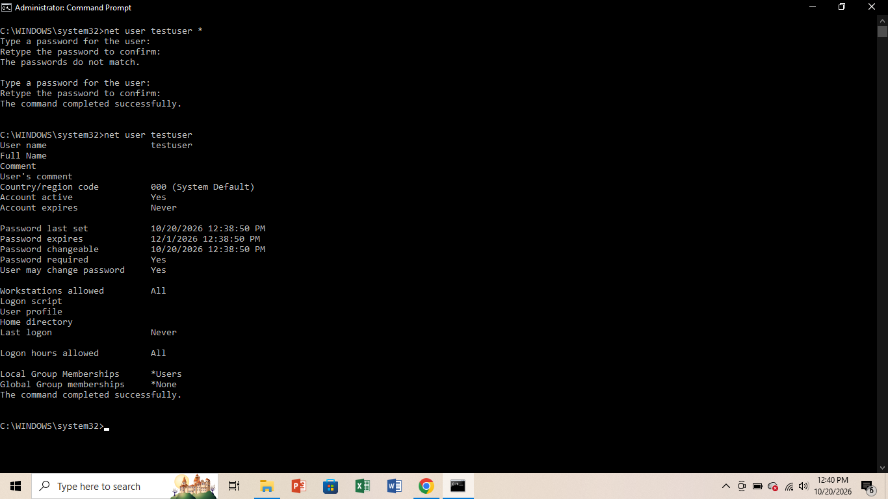

# Forgotten password

## A problem:
A user forgets the password for their Windows account and cannot sign in. I recreated this on my Lenovo laptop with the test account called testuser, then reset its password as an administrator.

## Tools:
Lenovo laptop running Windows 10 and Command Prompt (run as administrator).

##Troubleshooting steps:

### Step 1:  Open Command Prompt as administrator

I searched for cmd, right-clicked Command Prompt, and chose Run as administrator. Only an administrator can reset another account's password.

### Step 2: Create a test account

I typed `net user testuser (password) /add` to create a test account. The command completed successfully, and I used a made-up password so no real password appeared anywhere.

### Step 3: Reset the password

I typed `net user testuser *` so that Windows asked me for the new password and hid it while I typed. My first attempt showed "The passwords do not match" because I could not see what I typed. The second attempt worked.

### Step 4: Check that the reset worked

I typed `net user testuser` to view the account details. The account was active, and the Password last set line showed the time of the reset.

## What the results mean

-Account active: Yes: the account is not locked or disabled.
-Password last set shows today's date and time: the reset was applied.
-Last logon: Never: the test account has not been used to sign in yet.

## Limits of this method

- It only works for local accounts. A Microsoft account password has to be reset online.
- It needs an administrator account.
- Resetting a real user's password can make them lose saved passwords and encrypted files, so a technician should check with the user first.

 ## Security tip

Before resetting a password for anyone, confirm the person's identity, because attackers sometimes pretend to be a user to get access. Avoid typing the password in the command itself, because anyone looking at the screen can read it. Use `net user username * so the password stays hidden. Turning on multi-factor authentication also reduces the damage when a password is forgotten or stolen.

## What I learned
I learned why it is crucial to use `net user username *` so that password input remains hidden on the screen during a reset. I also gained a better understanding of the difference between local accounts and Microsoft accounts, as well as the administrative privileges required to manage local user credentials safely.
