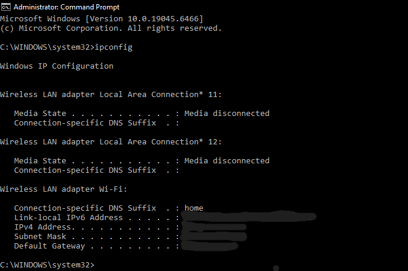

# No internet connection

## A problem: 

A user says their laptop shows it is connected to Wi-Fi, but they cannot access the internet. I used Command Prompt on the user's laptop to find out where the connection was failing.

## Tools used: 

A Lenovo laptop running Windows 10 Home and Command Prompt.

## Troubleshooting steps:

### Step 1: Check the network adapter with ipconfig.
I opened Command Prompt and typed `ipconfig` to the the network adapter.I looked for the Wi-Fi adapter and checked that it had an IPV4 address. This showed that the laptop was given an address by the router. (details covered in the screenshot.)

### Step 2: Check the internet connection with ping 8.8.8.8
I typed `ping 8.8.8.8` to check the internet connection. This sends a small test message to a Google server using its IP address. I received replies, which means the laptop can reach the internet.

### Step 3: Test DNS with ping google.com
I typed `ping google.com` to test DNS. This tests whether the laptop can turn a website name into an IP address, which is the job of DNS. I got replies, so DNS is working.

## What the results mean:

-**No IPv4 address in ipconfig:** would mean the laptop is not getting an address from the router. Check the Wi-Fi or cable connection, then reboot the router or the adapter.

-**ping 8.8.8.8 fails:** the laptop is on the local network but cannot reach the internet. The problem could be the router or the internet service provider.

-**ping 8.8.8.8 works but ping google.com fails:** this means there is a DNS problem. Try a different DNS server or reboot the router.

## Security tip:

Avoid doing sensitive things like online banking on public Wi-Fi. Use a VPN if you have to connect to one.

## What I learned:
 
Working with this issue taught me the importance of a systematic troubleshooting process. Testing step by step, from local IP configuration to external DNS resolution, allowed me to quickly isolate whether the fault was on the local machine, the router, or the internet provider. Documenting these steps also helped me understand how powerful Command Prompt is for quick diagnostics.
