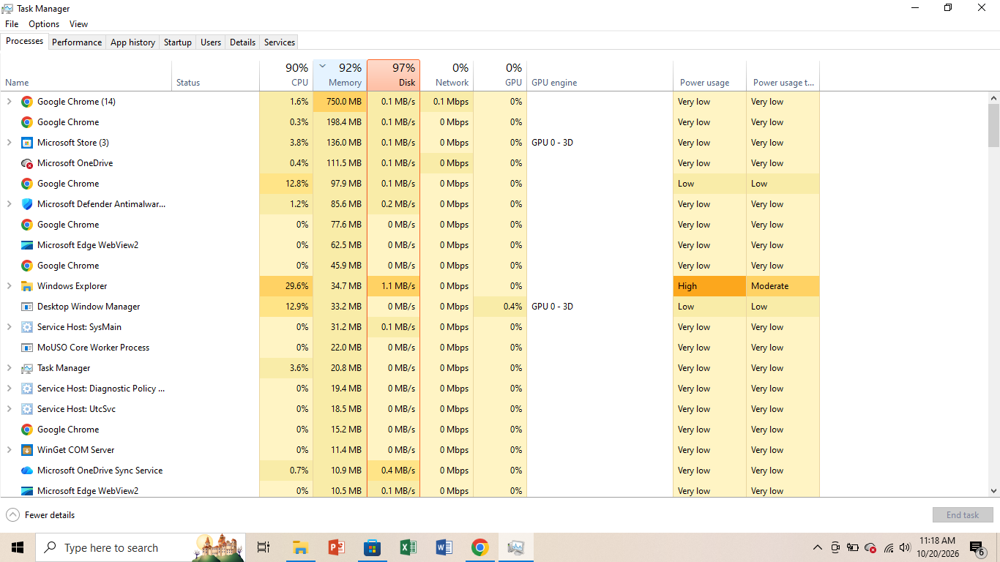
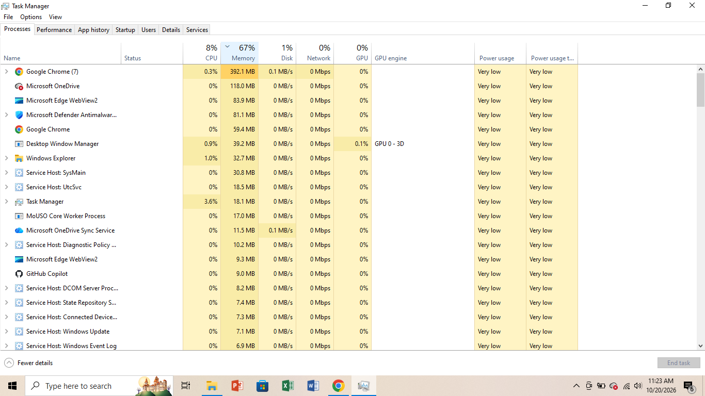

A slow computer.

A Problem:

A user says their laptop is very slow and programs take a long time to respond. I opened Task Manager on the user's laptop to find out what was consuming the resources.

Tools used:

Lenovo laptop running windows 10 and Task Manager.

Troubleshooting steps:

Step 1: I pressed Ctrl + Shift + Esc to open Task Manager and clicked the processes tab to check resource usage. I clicked the Memory column header so the programs using the most memory moved to the top. CPU was at 90%, Memory was at 92%, and Disk was at 97%, so the laptop was running very slow. Google Chrome was at the top with 14 processes and 750.0 MB of memory.

Step 2: Close the programs that are not needed. I opened Chrome and closed all the extra tabs, keeping only the tabs needed. I waited about 30 seconds and checked Task Manager again.

Step 3: Check the results. CPU dropped from 90% to 8%, Memory dropped from 92% to 67% and Disk dropped from 97% to 1%. Chrome went from 14 processes to 7, memory went from 750.0 MB to 392.1 MB. Closing the extra tabs fixed the issue.

Results:
          CPU   |  MEMORY| DISK  | CHROME PROCESSES| CHROME MEMORY
Before:  |90%   |92%     |97%    | 14              | 750.0 MB
After :  |8%    |67%     |1%     | 7               | 392.1 MB

What the results mean:
High memory above 80% mean that the computer is running very low on RAM and slows down. Close programs or browser tabs not in use.
High CPU mean a program is working very hard. Find it in the list and close it, or check whether it is malware.
High disk mean that a drive is busy. When memory runs out, Windows uses the disk instead, which makes everything slower.

what you can also try:

- Restart the computer
- Disable startup apps that are not needed (Task Manager, Startup tab)
- Add more RAM if the laptop allows it

Security tip

A computer that suddenly becomes slow can be infected with malware. Check Task Manager for programs you do not recognise and run a full scan with Windows Security.

What I learned:
I learned how quickly a web browser with multiple open tabs can consume system resources, spiking the CPU, RAM, and disk usage all at once. Monitoring all three metrics together helped me understand that when RAM runs out, Windows relies heavily on the hard drive for virtual memory, which severely slows down the system.

